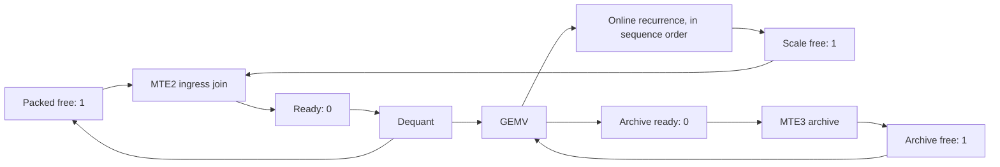

# Refining combat kernels: mandatory pipeline baseline

Applies to pipeline or buffer-lifetime refactors of real operators in this
repository. Target for the decode baseline: CANN 9.2.0-beta.2, `dav-3510`,
`Ascend950PR_9599`. Complete these gates before pushing a pipeline refactor
or tagging it for physical NPU execution. A failed or unavailable
gate is recorded as pending; compilation or a host mock cannot replace CAModel.
This procedure complements `SKELETON_KERNEL_WORKFLOW.md` and
`MICROROUTINE_DESIGN_GUIDELINES.md`.

## 1. Prove the token flow and simulate engine queues

Draw the marked graph before changing events. A HardEvent is one bit, so each
`(source, destination, ID)` place has capacity one. Every place has one producing
transition and one consuming transition. Pair routes and IDs exactly, use IDs
0..5, prime every feedback cycle, and explicitly drain every final credit,
including credits for slots unused by short or empty workers. A second SET
before consumption loses a token even if aggregate SET/WAIT counts match.

For the two-slot decode ring (`kStageDepth = 2`), for each slot `s`:

| Place | Route/ID | Initial marking | Producer → consumer |
| --- | --- | ---: | --- |
| Packed free | `V_MTE2`, `s` | 1 | dequant → packed ingress |
| Scale free | `V_MTE2`, `2+s` | 1 | recurrence → scale ingress |
| Ingress ready | `MTE2_V`, `s` | 0 | ingress join → dequant |
| Archive free, AIV only | `MTE3_V`, `s` | 1 | archive → GEMV |
| Archive ready, AIV only | `V_MTE3`, `s` | 0 | GEMV → archive |



The graph is instantiated twice. Vector queue order also supplies edges between
dequant, GEMV and recurrence transitions and serializes all updates of `m/l/acc`.
Dequant/GEMV and softmax share one Vector ALU; they cannot execute simultaneously.
Overlap means MTE2 and/or MTE3 execute while Vector is in flight.

Prefill `min(N, 2)` slots. At tick `i`, prepare strip `i` if it exists, retire
recurrence `i-1` if it exists, then enqueue ingress `i+1` into the retired slot.
The final tick only recurs the final strip. Each packed/scale ownership credit
is either free or owned by exactly one strip. A recurrence releases scales only
after their last Vector read; dequant releases packed bytes after both unpacks.
Each archive credit alternates free → score → DMA → free. One final WAIT moves
each remaining feedback credit to a terminal sink, leaving all hardware flags
zero. Forward ready places are consumed once for each actual strip.

An induction over slot generations proves 1-safety: a refill requires the
previous generation's credit, so it cannot overwrite that generation; the next
release requires consumption of the preceding ready token. Every directed
reuse cycle is initially marked. The finite prefill/prepare/retire schedule
contains no wait for a transition that will never be emitted. Exhaustive engine
interleaving exploration additionally checks bounded instances and ownership;
it is not a claim of exhaustive verification for every possible sequence length.

Run `python3 tests/cpu/test_decode_ring_model.py`. It explores every interleaving
for both kernels at N=0,1,2,3,4,5,8,16,64, rejects double SETs, unprimed cycles
and early scale release, and requires ordered recurrence and an empty final
marking. Keep model transitions consistent with the actual loop when editing it.

## 2. Compile-time memory checks

Compile the actual kernels with `-Wall -Werror`. Enforce 32-byte bases and DMA
sizes, non-overlapping live allocations, a 32-byte allocation skew between ring
slots, and different `floor(offset/32) mod 16` banks for paired slots (AKA3003).
Skew is checked against payload size; it is not a universal bank-conflict proof
for every instruction's repeat/stride pattern.

Packed keys/values, key/value scales, dequantized key/value pages, and raw score
panels have two slots. The nibble conversion buffer, GEMV temporaries and
recurrence temporaries are shared only in Vector FIFO order. No MTE engine
writes them during a Vector live range. Assert
`kArenaEnd + 256 <= kUbWindow <= 192*1024`; the final 256 bytes are an addressable
read pad, never payload. Give each 64-byte scale slice a private 256-byte landing before applying the
32-byte skew; an unmasked register read must not touch another DMA landing.
Check register overreads of short state/fold buffers too.
Keep scalar tensor extraction and `GetValue()` out of arithmetic; Split-K merges
all statistics together and streams accumulators in vector-register batches.
Scalar loop/address scheduling, block-table GM address loads and lock-control
branches are control flow, not scalar dequant/GEMV/softmax computation. Do not
introduce null TPipe calls or per-row scalar/MTE accumulation handshakes.

## 3. Isolated single-tile boundary canaries, before full sequences

Use one tile of the operator's real geometry. These decode kernels use
256 channels × 16 tokens, rather than changing their contract to an illustrative
128 × 128 shape. Test logical `page_idx=0`, `K/2`, and `K-1` with K=8 and a
non-identity block table. Keep the full cache/table allocations and nonzero
logical-page indices; rebasing the selected page to zero does not test offsets.
Also test the final strip within the final page (strip 7).

Flood every GM payload with `0x7FC0BEEF` before assigning only the selected
query/gate/cache/scale/table slices. This is an FP32 quiet NaN; packed int4 and
BF16 views are byte patterns, not guaranteed NaNs. Thus canaries detect writes,
and numerical checks detect wrong reads; do not claim that every int4 read
outside a slice necessarily produces a NaN. Signs are a shared real input.
Snapshot every input byte before upload, download after synchronization and
compare it bitwise. Verify every unassigned output slot/channel and both exterior
guards (`ASSERT_CANARY_INTACT`). For BF16, check the exact low/high half at its
original word position; accepting either half misses a halfword swap.

The exact boundary fixture uses query=1/256, key nibbles=3, scales=1 and gate=0.
Every score is exactly 3 and exp(0)=1. Values depend on logical strip and channel.
Values use a positive even baseline and one odd channel, keeping both division
numerators and dense rotation outputs nonzero while preserving exact arithmetic.
An independent scalar token sum and dense rotation matrix supply the oracle.
Require byte-exact scores, replicated m/l, accumulators, rotation and BF16 output
where exported. Split-K's production interface exports context and protocol
metrics only; its isolated probe checks exact context, protocol fields and all
unassigned bytes. It calls the same `ProcessItem` and reduction as production.
The regular varied-score fixture remains a separate arithmetic regression with
its documented Exp/reduction tolerances; do not relax exact boundary checks to
make that fixture pass.

## 4. Full-depth and wrap tests

Only after all three boundaries pass, test N=depth and N>=2*depth (here 2 and 4),
then odd counts, multiple pages, repeated launches and real Split-K workers,
including empty workers. Boundary isolation does not prove contention/reuse.
Preserve the same canary and oracle gates as sequence length grows. Do not infer
the tail-worker merge path from a single-worker probe.

## 5. Trace audit and instruction census

Use each run's own `core*.instr_popped_log.dump` and completion logs. Audit every
core, require real Vector work on at least one, and fail on missing traces,
timeouts, model errors or nonempty exception dumps. Key events by operand route
and ID, not by the queue column. Require equal counts, SET/WAIT alternation in
program order, capacity-one markings in completion order, and zero final tokens.
CAModel omits some register barriers from completion logs; flag completion
counts must nevertheless match dispatch counts exactly. At N strips, slot s
must have `1 + floor((N+1-s)/2)` SET/WAIT pairs on each packed/scale feedback
route; the leading one is the prologue/epilogue credit, even for unused slots.

Run `scripts/analyze_decode_ring_trace.py`, the AIV instruction/traffic census,
and the Split-K batched lock audit. Report engine counts and actual intersecting
MTE2/Vector intervals for an overlap claim; source order and balanced events
alone do not establish overlap. Do not interpret simulator ticks as silicon
throughput. Keep commands, logs, counts, canary totals, numerical results and
limitations in a report under `reports/`.

The reproducible boundary baseline is:

```bash
bash scripts/run_decode_pipeline_camodel.sh
```

It creates a fresh ext4 source/build/evidence directory under `/tmp`, prints its
path, runs host probes and strict compilation, then tests both kernels at the
three boundaries, depth=2 and wrap=4. The existing varied-score and production
Split-K runners provide the subsequent full-sequence regressions.

For the subsequent varied-score regressions, build the existing
`bench_decode_splitk_sim` target in a fresh CMake build with the same toolkit
and SoC, then run:

```bash
# Build the simulator benchmark from current sources without launching it.
decode_bench_dir=$(mktemp -d /tmp/ascend-decode-bench.XXXXXX)
SPLITK_SRC_DIR="$decode_bench_dir/src" SPLITK_BUILD_DIR="$decode_bench_dir/build" \
  bash scripts/run_decode_splitk_bench.sh sim --help
bash scripts/run_decode_pipeline_regressions.sh BASELINE_DIR "$decode_bench_dir/build"
python3 scripts/verify_decode_pipeline_evidence.py BASELINE_DIR
```

`BASELINE_DIR` is the printed `/tmp/ascend-decode-ring.*` directory. The script
requires all ten baseline passes before running the six-row, two-page, odd-tail,
K=2 wrap/merge and K=4 empty-worker cases. It uses the baseline kernel libraries
with the current benchmark ABI, checks model errors/exception dumps and audits
each case's own traces. Full varied-score arithmetic uses its existing documented
numerical budgets; exact boundary outputs remain a bitwise gate.
